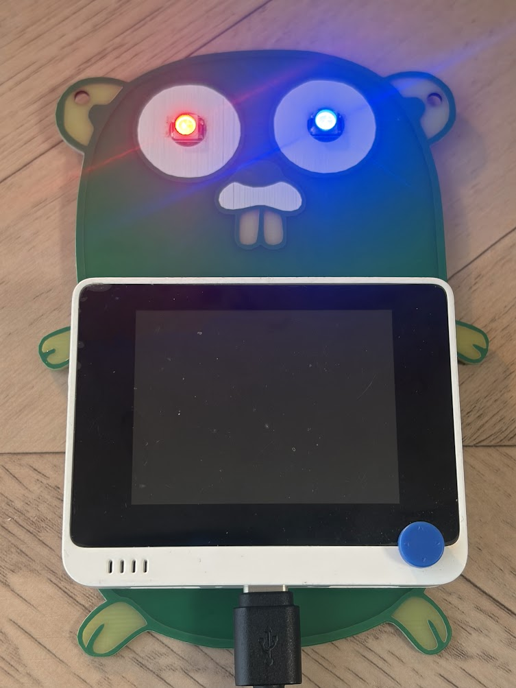

# wio-gopher

Wio Terminal の背面 40pin ヘッダに挿す、Gopherくんデザインの基板です。
Gopher の目に WS2812B (フルカラー LED) を 2 個載せていて、TinyGo で光らせます。



## ファイル構成

| パス | 内容 |
|---|---|
| `wio-gopher.kicad_pro` / `.kicad_sch` / `.kicad_pcb` | KiCad プロジェクト |
| `lib/`, `lib.pretty/` | Wio Terminal 40pin ヘッダのシンボル / フットプリント |
| `wio-gopher/`, `wio-gopher.zip` | ガーバー・ドリルデータ |
| `firmware/` | TinyGo のファームウェア |

## 回路

| Wio Terminal 40pin | 接続先 |
|---|---|
| 1 (3V3) | D1, D2 VDD |
| 7 (PB14 / BCM4) | D1 DIN |
| GND | D1, D2 VSS |

D1 の DOUT は D2 の DIN につながっています。

## ファームウェア

パチンコ台風に、次の流れで光ります。

通常 (虹色) → リーチ (赤青の交互点滅が加速) → 抽選 → 大当たり (ストロボ連発) / ハズレ (赤がフェードアウト)

### 必要なもの

- [TinyGo](https://tinygo.org/)
- [tinygo.org/x/drivers](https://github.com/tinygo-org/drivers) (ws2812)

### 書き込み

Wio Terminal を USB で PC につないで、次を実行します。

```bash
cd firmware
tinygo flash -target=wioterminal .
```

### 注意

- 40pin ヘッダの 3V3 は、`OUTPUT_CTR_3V3` (PC15) を Low にしないと出力されません。TinyGo は起動時にこれを設定しないので、ファームウェアの中で有効にしています。
- WS2812B の電源電圧の仕様は 3.5V 以上なので、3.3V での給電は仕様外です。表示が乱れる場合は `firmware/main.go` の `brightness` を下げてください。

## ライセンス

[MIT](LICENSE)
